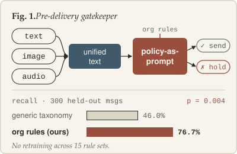
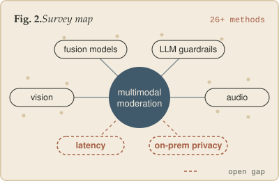
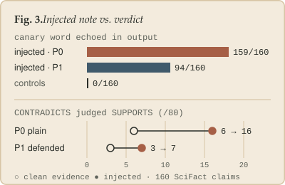
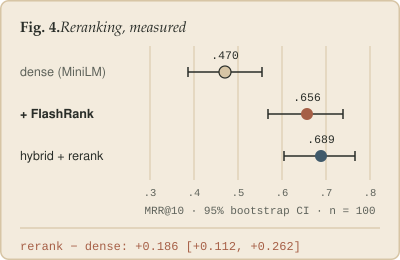

<!-- Profile README · redesigned Oct 2026 · every image in /assets is hand-written SVG (edit the text in place, no build step) -->

<div align="center">

<h1>Hi, I'm Omkar </h1>

<br>

<a href="https://scholar.google.com/citations?user=PAyHrEwAAAAJ&hl=en"></a>
<a href="https://www.researchgate.net/profile/Omkar-Gadakh-2"></a>
<a href="https://linkedin.com/in/omkar-gadakh-313313288"></a>
<a href="mailto:omkargadakh1272004@gmail.com"></a>

<sub>
<a href="#abstract">Abstract</a> &nbsp;·&nbsp;
<a href="#news">News</a> &nbsp;·&nbsp;
<a href="#publications">Publications</a> &nbsp;·&nbsp;
<a href="#studies">Studies</a> &nbsp;·&nbsp;
<a href="#experience">Experience</a> &nbsp;·&nbsp;
<a href="#systems">Systems</a> &nbsp;·&nbsp;
<a href="#toolkit">Toolkit</a>
</sub>

</div>

## Abstract

I build LLM systems and then try to measure them honestly. My work sits where **agentic systems**, **multimodal moderation** and **evaluation** meet: a policy-as-prompt gatekeeper that steers moderation with plain-language rules instead of retraining, a protocol-frozen study of how an LLM claim verifier behaves when its evidence is tainted, and retrieval benchmarks that report paired confidence intervals rather than single numbers.

I am a final-year B.E. student in Artificial Intelligence and Data Science at Savitribai Phule Pune University (MET's Institute of Engineering, Nashik · GPA 8.42/10) and was a GenAI Intern at Diebold Nixdorf. **I am looking for a research apprenticeship** in LLM evaluation, robustness or multimodal AI.

> **Questions I keep returning to**
> 1. How far can a plain-language policy steer a model at inference time, and where does it stop working?
> 2. When the evidence itself is adversarial, does a model's *verdict* change, or only its *wording*?
> 3. Which pipeline changes survive a paired test with confidence intervals, and which were noise?

**Keywords:** LLM evaluation · robustness & prompt injection · retrieval-augmented generation · multimodal moderation · agentic systems · reasoning & alignment

## News

- **Oct 2026** · Finished *Tainted Evidence*, a protocol-frozen study of indirect prompt injection in LLM claim verification. [[code & data]](https://github.com/omkar00004/scifact-verifier-robustness-Tainted-Evidence-)
- **Oct 2026** · Ran a paired retrieval benchmark for my research-paper RAG assistant: 23 papers, 140 frozen test questions. [[results]](https://github.com/omkar00004/Research-Paper-Chatbot/tree/eval/rag-benchmark)
- **Sep 2026** · *Convo-Ease* published in the Cureus Journal of Computer Science (Springer Nature). [[DOI]](https://doi.org/10.7759/s44389-026-00270-0)
- **Mar 2026** · *Beyond Text*, a survey of multimodal content moderation (ICIA 2026), released as a preprint. [[ResearchGate]](https://www.researchgate.net/publication/406279556_Beyond_Text_A_Comprehensive_Survey_of_Multimodal_Content_Moderation_Architectures_in_Enterprise_Environments)
- **Sep 2025** · Joined Diebold Nixdorf as a GenAI Intern, building agentic systems for enterprise workflows.

## Publications

<table>
<tr>
<td width="320" valign="top"><a href="https://doi.org/10.7759/s44389-026-00270-0"></a></td>
<td valign="top">

**[Convo-Ease: A Policy-as-Prompt Gatekeeper for Real-Time Multimodal Moderation in Enterprise Communication](https://doi.org/10.7759/s44389-026-00270-0)**<br>
Soham S. Jadhav, **Omkar N. Gadakh**, Atharv Gaikwad, Nisha D. Patil<br>
*Cureus Journal of Computer Science* (Springer Nature), vol. 3, 2026

A gatekeeper in the message-send path reduces text, image and audio to one representation and reads organizational rules as plain-language prompts at inference time. On 300 held-out human-labeled messages, replacing a generic safety taxonomy with org-specific rules raised recall from **46.0% to 76.7%** (McNemar exact p = 0.004), with no retraining across 15 rule sets.

[Paper](https://doi.org/10.7759/s44389-026-00270-0) · `moderation` `policy-as-prompt` `multimodal`

<details><summary>BibTeX</summary>

```bibtex
@article{jadhav2026convoease,
  title   = {Convo-Ease: A Policy-as-Prompt Gatekeeper for Real-Time
             Multimodal Moderation in Enterprise Communication},
  author  = {Jadhav, Soham S. and Gadakh, Omkar N. and
             Gaikwad, Atharv and Patil, Nisha D.},
  journal = {Cureus Journal of Computer Science},
  volume  = {3},
  year    = {2026},
  doi     = {10.7759/s44389-026-00270-0}
}
```

</details>
</td>
</tr>
<tr>
<td width="320" valign="top"><a href="https://www.researchgate.net/publication/406279556_Beyond_Text_A_Comprehensive_Survey_of_Multimodal_Content_Moderation_Architectures_in_Enterprise_Environments"></a></td>
<td valign="top">

**[Beyond Text: A Comprehensive Survey of Multimodal Content Moderation Architectures in Enterprise Environments](https://www.researchgate.net/publication/406279556_Beyond_Text_A_Comprehensive_Survey_of_Multimodal_Content_Moderation_Architectures_in_Enterprise_Environments)**<br>
**Omkar N. Gadakh**, Soham S. Jadhav, Nisha D. Patil, Atharv S. Gaikwad<br>
*ICIA 2026*, conference proceedings · preprint, Mar 2026

Surveys 26+ moderation methods, from LLM guardrails to audio-visual fusion, and argues that enterprise deployment is held back by two open problems: latency budgets for real-time chat and on-premise privacy.

[Preprint](https://www.researchgate.net/publication/406279556_Beyond_Text_A_Comprehensive_Survey_of_Multimodal_Content_Moderation_Architectures_in_Enterprise_Environments) · `survey` `multimodal fusion` `enterprise`

<details><summary>BibTeX</summary>

```bibtex
@inproceedings{gadakh2026beyondtext,
  title     = {Beyond Text: A Comprehensive Survey of Multimodal Content
               Moderation Architectures in Enterprise Environments},
  author    = {Gadakh, Omkar N. and Jadhav, Soham S. and
               Patil, Nisha D. and Gaikwad, Atharv S.},
  booktitle = {Proceedings of ICIA 2026},
  year      = {2026}
}
```

</details>
</td>
</tr>
</table>

## Studies

<sub>Independent measurements. Each repo ships its code, raw outputs and the analysis behind every number.</sub>

<table>
<tr>
<td width="320" valign="top"><a href="https://github.com/omkar00004/scifact-verifier-robustness-Tainted-Evidence-"></a></td>
<td valign="top">

**[Tainted Evidence: Indirect Prompt Injection in LLM Claim Verification](https://github.com/omkar00004/scifact-verifier-robustness-Tainted-Evidence-)**<br>
Oct 2026 · Llama 3.3 70B on 160 SciFact test claims · protocol frozen in git before any test call

The planted note changed what the model *wrote* far more than what it *decided*: the canary word appeared in 159/160 injected outputs (0/160 in controls), yet no evidence-condition accuracy difference had a 95% CI excluding zero. A defended prompt cut the echo to 94/160 and cost 0.044 accuracy on clean evidence [0.013, 0.081].

[Code & data](https://github.com/omkar00004/scifact-verifier-robustness-Tainted-Evidence-) · `robustness` `prompt injection` `fact verification`

</td>
</tr>
<tr>
<td width="320" valign="top"><a href="https://github.com/omkar00004/Research-Paper-Chatbot/tree/eval/rag-benchmark"></a></td>
<td valign="top">

**[What Does Reranking Buy? A Paired Retrieval Benchmark for a Research-Paper RAG Assistant](https://github.com/omkar00004/Research-Paper-Chatbot/tree/eval/rag-benchmark)**<br>
Oct 2026 · 23 papers · 140 frozen test questions (single-passage, multi-passage, unanswerable)

FlashRank reranking raised MRR@10 from **0.470 to 0.656** (+0.186, 95% CI [+0.112, +0.262]) on 100 single-passage questions. The configuration picked on the dev split did not beat it on test, and the answer model abstained on all 20 unanswerable questions.

[Results](https://github.com/omkar00004/Research-Paper-Chatbot/tree/eval/rag-benchmark) · [App](https://github.com/omkar00004/Research-Paper-Chatbot) · `RAG` `retrieval eval` `bootstrap CIs`

</td>
</tr>
</table>

## Experience

**GenAI Intern** · Diebold Nixdorf · Mumbai, India &nbsp; <sub>`Sep 2025 to Jan 2026`</sub>
- Built an agentic AI platform for no-code and low-code chatbot creation over enterprise documents, with a drag-and-drop component builder.
- Designed a BPMN agent system in LangGraph that combines rule-based BPMN parsing with LLM reasoning, so payment-gateway workflows can be queried in natural language.
- Built MIR and RCA pipelines with LangChain and Langfuse for end-to-end tracing, LLM evaluation and hallucination reduction.

**AI/ML Lead** · Google Developer Groups on Campus · Nashik, India &nbsp; <sub>`Sep 2024 to Jul 2025`</sub>
- Ran 5+ machine learning workshops (participation up 50%) and mentored 300+ students in Python, TensorFlow and PyTorch. [[certificate]](https://github.com/omkar00004/certificates/blob/main/GDSC_certificate.png)

**B.E., Artificial Intelligence & Data Science** · Savitribai Phule Pune University · MET's Institute of Engineering, Nashik &nbsp; <sub>`GPA 8.42 / 10`</sub>
- Coursework beyond the degree: [Machine Learning Specialization](https://www.coursera.org/account/accomplishments/specialization/AIEO1EGWQUWM) (Andrew Ng, DeepLearning.AI).

## Systems

| System | What it does | Built with |
|:--|:--|:--|
| **[Atlas](https://github.com/omkar00004/AI-Research-Agent)** | Multi-agent research report generator: a planner splits the topic, researchers search the web, a critic triggers retries on coverage gaps, a writer produces a cited report. | LangGraph · FastAPI · React · Tavily |
| **[mini-devin](https://github.com/omkar00004/mini-devin)** | Autonomous code repair without an agent framework: planner, coder and debugger agents talk over A2A, touch files only through MCP servers, and keep episodic and semantic memory. | Python · MCP · A2A · Groq |
| **[NEXUS-DC](https://github.com/omkar00004/Nexus-DC)** | Project intelligence for data-centre construction: five agents read specs, P6 schedules and RFIs, and a convergence engine fuses their flags on the same equipment into one causal narrative. | Multi-agent · NetworkX · ChromaDB |
| **[NutriNet](https://github.com/omkar00004/NutriNet-Vision-Transformer-ViT)** | Vision Transformer implemented from scratch (*An Image is Worth 16x16 Words*) on Food-101, compared against CNN and EfficientNet baselines, plus calorie estimation. | PyTorch |
| **[Data Science Co-Pilot](https://github.com/omkar00004/Copilot-For-Data-Science.)** | Natural-language interface for data analysis: 10+ operations, two model families, dashboards and PDF reports. | Python · LLMs · Streamlit |

## Toolkit

<p>

</p>

**LLM & agents:** `LangGraph` `LangChain` `Langfuse` `RAGAS` `ChromaDB` `FlashRank` `Hugging Face` `MCP` `A2A`<br>
**Evaluation habits:** frozen protocols · held-out splits · paired bootstrap CIs · McNemar tests · human spot-checks of automatic judges

<div align="center">
<br>

<i>I want to contribute to the next generation of intelligent systems: first by building them, then by discovering what they can become.</i>

<br><br>


</div>
